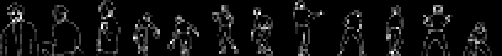
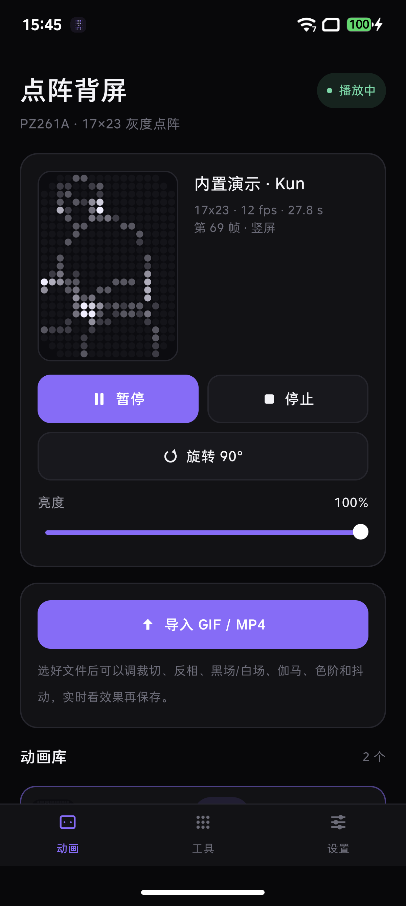
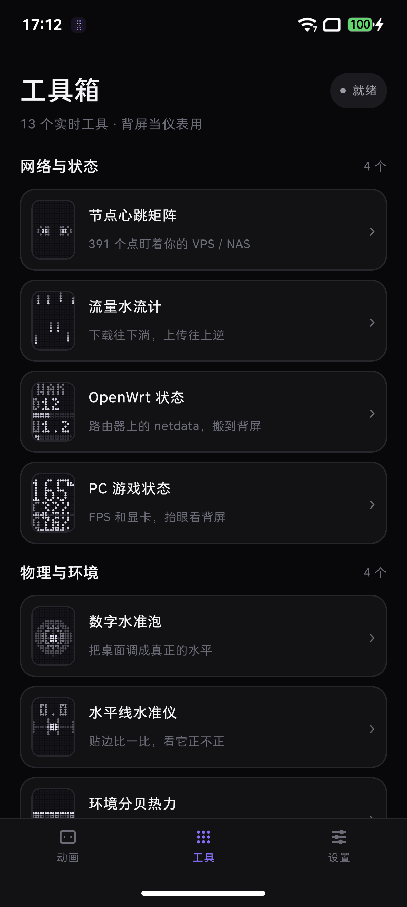
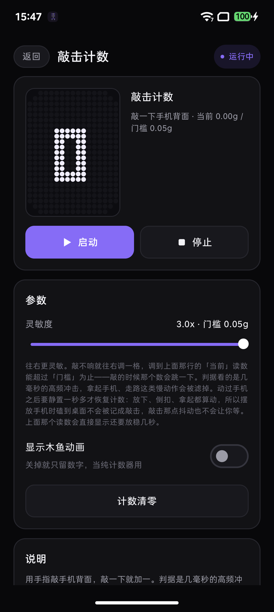
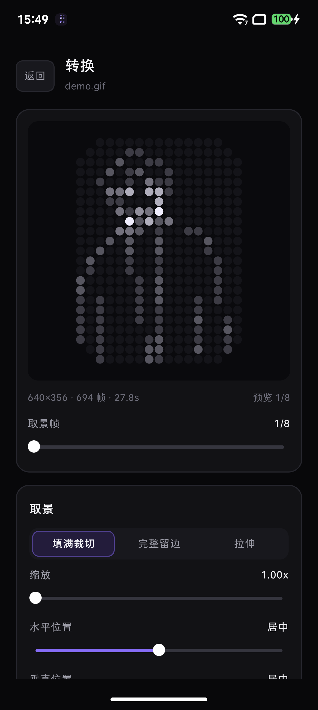
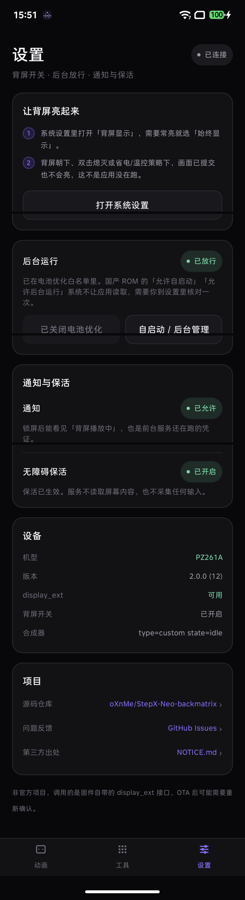

# StepX Neo Back Matrix · 点阵背屏

把 GIF / MP4 转成点阵动画，推到 STEPX PZ261A 的 17×23 灰度背屏上；另带一套实时工具，
把这块背屏当服务器指示灯、物理仪表、专注计时器和桌面玩具用。

> An unofficial Android app that drives the 17×23 grayscale back screen of the STEPX PZ261A:
> GIF/MP4 → dot-matrix animation, plus 13 live tools.




## 界面

| 动画 | 工具箱 | 工具详情 |
| --- | --- | --- |
|  |  |  |

| 转换 | 设置 |
| --- | --- |
|  |  |

截图拍自 PZ261A 真机（1200×2670），右上角的"就绪"表示 `display_ext` 服务可达。

## 动画

- 导入 **GIF 或 MP4**，按 17×23 重新采样，不是简单缩放
- 取景（填满 / 留边 / 拉伸、缩放、平移）、明暗（反相、黑场、白场、伽马）、色阶（2/4/8/16/连续）、抖动都可调，边调边看真实点阵预览
- 结果存进动画库随时重播；播放走前台服务，锁屏、切后台继续推帧
- 内置一段预转换的示例动画（`assets/demo_basketball.bsa`），装完就能播；原始视频素材不入库

## 工具箱

13 个工具的帧是现算的，不是播动画。参数都在详情页，改完按「启动 / 重启」生效。

| 工具 | 做什么 |
| --- | --- |
| 节点心跳矩阵 | 一格一台机器，TCP 探测存活；活着按节奏呼吸，挂了整块爆闪，全挂显示大感叹号。SSH / MySQL / Redis / RDP 都能探，不限 HTTP |
| 流量水流计 | 读网卡计数器，下载往下淌、上传往上逆，越快越密越急 |
| OpenWrt 状态 | 直读路由器上 netdata 的 v1 接口（默认 19999），显示 WAN 上下行或 CPU / 内存 / 磁盘 / 负载 / 连接数 |
| PC 游戏状态 | 读 PC 上 rig-exporter 的 `/api/status`（默认 8787）：大号 FPS，外加最多三个指标 |
| 数字水准泡 | 加速度算倾角，气泡随重力滑动，水平时亮一圈光晕 |
| 水平线水准仪 | 一条轨道加一个气泡，判断边缘放没放平；竖拿量顶边、横拿量长边 |
| 环境分贝热力 | 麦克风 RMS 当分贝，安静时只有底层波纹，声音大了能量柱顶到最上一行 |
| 地磁航向针 | 针固定朝上代表你正对的方向，北点绕表圈转，转到头顶就是正朝北 |
| 倒扣禅定 | 倒扣开始倒计时，像素从边缘沙化剥落；提前翻开立刻碎心并记一次失败 |
| 摇一摇骰子 | 摇出骰子面 / 硬币正反面 / 转停的箭头 |
| 敲击计数 | 敲一下背面加一，带木鱼动画。判据是高频冲击 + 静置闸门，放下手机的过程不计 |
| 落沙沙盒 | 元胞自动机，沙粒按重力滚落堆叠，重力跟着姿态走 |
| 蓝牙雷达 | 扫线转圈，扫到的设备在对应方位激起涟漪（方位由地址散列，装饰性的） |

两个遥测工具只发 HTTP GET，局域网明文 `http` 也能用，地址写 `192.168.1.1:19999` 会自动补协议头。
服务连不上时屏幕上是闪烁的 `OFF` 加一行小字。

17 点宽只放得下「1 个字母 + 3 个字符」，所以一次最多三个指标，每个占一整行。勾满三个后其余项置灰。

## 安装与上手

1. 装 `app-release.apk`（或 `app-debug.apk`），两者都直接可装
2. 系统设置 → 显示 → 打开「背屏显示」；想常亮就选「始终显示」
3. 首次启动会依次申请通知权限和后台运行放行；「无障碍保活」是可选的第三档，开了进程更不容易被回收
4. 回来点播内置示例，或「导入 GIF / MP4」→ 调参数 → 「保存并播放」

背屏朝下、被双击熄灭、或处于省电 / 温控策略时，即使帧已提交也不会点亮，这是系统行为。

## 背屏接口

PZ261A 固件注册了一个 `display_ext` 系统服务，没有 SDK 也没有 AIDL，只能反射调用：

| 方法 | 说明 |
| --- | --- |
| `setBackScreenAgentFrame(int[] pixels, Bundle extras)` | 提交一帧：**391 个 0..255 灰度值**，索引 `y*17+x`，原点左上；传 `null` 交还背屏 |
| `getBackScreenAnimationInfo()` | 合成器状态，仅用于诊断 |

- 面板竖屏 17×23；旋转时只能用中央 17×17 安全区（按面板中心 (8,11) 做整数 90° 旋转）
- **四角是圆角，物理上没有那几个点**：`y=0` 和 `y=22` 只有 `x=2..14`，`y=1` 和 `y=21` 只有 `x=1..15`，
  中间 19 行是完整的 17 点。规则写在 `Dot.visible()`，`Scene` 的写入原语都会先查它，排版不用各工具避一次
- 只有一个 agent 通道，来电 / 相机等场景由固件决定优先级，应用抢不过
- 机型不对或服务不存在时界面直接标出来

## 转换管线

```
GIF/MP4 ─→ 取景(cover / contain / stretch + zoom / pan)
        ─→ 面积平均降采样到 17×23
        ─→ 反相 / 黑场 / 白场 / 伽马
        ─→ 色阶量化(2/4/8/16/256) + 可选 8×8 Bayer 抖动
        ─→ 时间重采样到目标 fps（上限 600 帧）
        ─→ .bsa 帧序列（391 B/帧）
```

取舍：面积平均而非最近邻（391 个点太小，最近邻会把线稿整条丢掉）；黑场默认 0.08（压掉 GIF 白区灰噪点）；
视频逐帧走 `MediaMetadataRetriever`；帧率上限 24，再高面板也刷不出来。

`.bsa` 格式（小端）：

```
"BSA1" | version u8 | flags u8(bit0=loop) | fps u8 | width u8 | height u8
       | frameCount u16 | nameLen u16 | name(UTF-8) | frameCount × 391 B
```

## 构建

需要 JDK 17 与 Android SDK（compileSdk 35、build-tools 35.0.0）：

```bash
export JAVA_HOME=/path/to/jdk17
export ANDROID_HOME=/path/to/Android/sdk

./gradlew testDebugUnitTest   # 79 项单测：转换器 / GIF 解码 / .bsa 编解码 / 旋转 / 绘图原语 / 工具
./gradlew assembleDebug       # app/build/outputs/apk/debug/
./gradlew assembleRelease     # app/build/outputs/apk/release/
```

CI 见 `.github/workflows/build.yml`：push 到 `main`、PR、手动触发都会跑单测并产出两个 APK；
推 `v*` tag 时自动建 Release 并附上 APK。**release 变体用 debug 证书签名**，只为方便直装，
要正式分发请换成自己的 keystore。

重新生成内置示例（与 App 内管线同一套数学，改参数两边要一起对）：

```bash
python3 -m pip install pillow
python3 tools/convert_demo.py your-clip.gif \
  --out app/src/main/assets/demo_basketball.bsa \
  --name "内置演示" --fps 12
```

## 目录

```
app/src/main/java/com/stepx/backmatrix/
├── core/     Dot 常量与旋转、Scene 绘图原语与 3×5 字体、Converter 管线、GifDecoder、.bsa、BackScreen 反射
├── player/   MatrixPlayer（动画 / 工具两种驱动源共用一条去重管线）、PlaybackService
├── tools/    Tool 框架与注册表、NetTools、FeedTools、SensorTools、PsychoTools、ArtTools
└── ui/       Compose 界面：动画页、工具箱、工具详情、转换页、设置页、点阵画布
tools/convert_demo.py             桌面端同款转换，生成内置资源
```

新增工具只需三步：在 `Tools.all` 加一条 `ToolSpec`、在 `Tools.create()` 加一个分支、
实现 `ToolInstance` 往 391 字节缓冲里画（用 `Scene` 原语），播放器不用动。

## 已知限制

- 换固件版本后 `display_ext` 的行为可能变，灰度语义与亮度曲线没有逐项核对过
- 长视频解码慢（27 秒约 60 秒采完），更长的请先剪短
- 遥测接口按具体实现调的：netdata 的 `net.*` 里 `sent` 是负数（已取绝对值），
  `system.cpu` 有的版本没有 `idle` 维度；rig-exporter 靠解析 `"25.0 %"` 这类带单位的字符串，
  对方改文案会导致对应指标不显示（不会显示成 0）
- 敲击计数分不出「敲背面」和「敲桌子」，放在桌上敲桌子同样会记；把手机平移着放到桌面
  （机身不转）时静置闸门攒不够，也可能误计，灵敏度调低一档即可
- 蓝牙雷达的方向是地址散列的固定值，手机没有测向天线，**方向是装饰性的**
- 不读取通知，不上传数据；联网只用于节点探测、流量计数和读 netdata / rig-exporter

## 许可与出处

代码 MIT，见 [LICENSE](LICENSE)。非官方项目，与 STEPX 无关联，厂商接口、固件与品牌不属于本项目。

旋转投影（`Dot.rotate`）与 3×5 字模的一部分派生自
[stepx-advance/backscreen-toolbox](https://github.com/stepx-advance/backscreen-toolbox)（MIT），
其版权行与逐项对照表，以及示例素材和第三方库的说明见 [NOTICE](NOTICE.md)。
